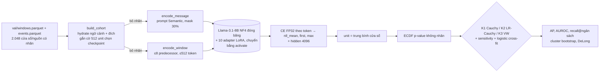

# FUSION_IMPLEMENTATION_PLAN — Thiết kế và hiện thực FUSION-E1

## 1. Đặc tả

| Mục | Giá trị đã kiểm chứng |
|---|---|
| Model A checkpoint | Semantic `P2.1-FINAL-{HDFS,HADOOP}-S42` best step 600 / 500 (`5ca88f60…`, `73d6734e…`); latest 900 / 800 |
| Model B checkpoint | Sequence `P2.2-DEVELOPMENT-{BGL,HDFS,HADOOP}-S42-V13R1` best 300/100/100 (`ee42f1ec…`, `b6012c13…`, `51fbb71c…`); latest 600/400/400 |
| Feature extraction | Logits của LM head → cross-entropy FP32 trên các token nhãn. Hidden state cuối (4096) của các vị trí dự đoán token đích, lấy trung bình; lưu FP16 để dùng làm baseline mật độ, **không** dùng trong K1–K3 |
| Shape | `input_ids` [B, L ≤ 512]; logits [B, L, 128256]; NLL token [n_tok] → vô hướng `nll_mean`; hidden [4096] |
| Projection / alignment | Không cần projection. Alignment theo unit: window_id → target_rank → unit (BGL dòng, HDFS block = trung bình các cửa sổ) |
| Normalisation | p-value ECDF không dùng nhãn: p = (1 + #{r > s} + ½·#{r = s})/(n + 1) |
| Fusion module | K1 Cauchy: T = ½[tan((½ − p_sem)π) + tan((½ − p_seq)π)]; K2 = K1 trên r = NLL_adapter − NLL_base; K3 = −log(½(p_sem + p_seq)) |
| Gating / attention | Không có trong luật chính. Comparator: logistic σ(w₀ + w₁·Φ⁻¹(1 − p_sem) + w₂·Φ⁻¹(1 − p_seq)), L2 = 1, cross-fit |
| Prediction head / output | Điểm bất thường (càng lớn càng bất thường); ngưỡng = ngân sách cảnh báo (top 1% / 5%) hoặc lượng tử buffer ở giai đoạn đích |
| Loss | K1–K3 không có. Comparator: logistic NLL + L2, Newton–Raphson |

## 2. Luồng dữ liệu

## 3. Module (`src/seqlogad/fusion/`, nằm ngoài implementation digest)

| File | Trách nhiệm |
|---|---|
| `units.py` | Dựng cohort source-dev từ bundle + sidecar; dựng lại đúng 512 unit chọn checkpoint; bản sao không nhãn |
| `artifacts.py` | Giải nén an toàn, kiểm `.sha256`, ledger checkpoint và identity; bridge Semantic cho lỗi hash cấu hình |
| `loading.py` | Một base NF4 + mọi adapter; `prepare_model_for_kbit_training` giống lúc validation; `activate()` đóng băng lại sau `set_adapter` |
| `scorer.py` | Encode giống hệt lúc train; chia batch theo token budget; NLL theo token, hidden state |
| `parity.py` | Fail-closed: phải tái lập AUROC/AP/NLL đã ghi của checkpoint best |
| `calibration.py`, `rules.py`, `learned.py` | p-value, luật fusion, comparator học được |
| `baselines.py` | B0: −log tần suất và Markov bậc 1 trên SOURCE_TRAIN |
| `metrics.py` | AP, AUROC, recall@ngân sách, DeLong ghép cặp, cluster bootstrap |
| `run_scoring.py` | Entry point GPU |
| `evaluate.py` | Entry point CPU → `results.json` + `summary.json` |

Cấu hình: `configs/fusion/fusion-e1.yaml`. Môi trường: `configs/fusion/requirements-fusion-e1.txt`, giống lock của lúc train V13R1 + scipy, pytest. Runbook pod: `scripts/fusion_e1_runpod.sh`.

## 4. Test đã chạy trước khi dùng GPU

30/30 pass trên CPU, Projmem `run_c4320284e319419291a44878871d49bb`. 32 test Sequence cũ pass, Projmem `run_2c71711d26f845a2b010d835dea7dc5b`.

| Yêu cầu | Test | Kết quả |
|---|---|---|
| Checkpoint nạp đúng, toàn vẹn | `test_fusion_artifacts.py`: identity bridge, checkpoint latest bị sửa, sidecar sai, ZIP có đường dẫn nguy hiểm, digest Sequence | PASS. **Nạp thật 8B chỉ làm được trên GPU (bước parity)** |
| Shape đầu ra và feature | `test_fusion_scorer.py`: hidden (32,) trên Llama tí hon, `n_tokens` | PASS |
| Forward fusion | `test_fusion_statistics.py`: các luật đơn điệu, copula một phía | PASS |
| Loss / backprop / gradient | Luật chính không có tham số, nên **N/A**. Comparator logistic: test hội tụ khôi phục đúng trọng số | PASS |
| Tham số đóng băng | `assert_frozen`; phát hiện `set_adapter` của PEFT bật lại gradient, nên thêm `activate()` | PASS (đã sửa lỗi thật) |
| Data loading | `test_fusion_cohort.py`: đếm cohort khớp số đã ghi; bản sao không nhãn; B0 | PASS |
| Lưu/nạp checkpoint | Không có checkpoint fusion (0 tham số); lưu kết quả qua JSONL/NPY + manifest | PASS (điều phối) |
| Batch = single | Sai lệch NLL ≤ 1e-5 trên mô hình tí hon | PASS |
| Điều phối end-to-end | `test_fusion_run_scoring.py`: parity sai thì dừng; chạy đủ thì ghi 6 job; không có nhãn trong điểm | PASS |
| Pipeline đánh giá | `test_fusion_cohort.py`: cohort thật + điểm ngẫu nhiên (1.536 unit, 67 dương) | PASS |
| Hash identity | Digest vẫn `78a18851…` sau khi thêm `fusion/` | PASS |
