# Sequence Expert V13R1: kiểm tra kiến trúc, lý thuyết và bộ chạy RunPod

Ngày kiểm tra: 2026-10-04. Trạng thái: **đã kiểm tra cục bộ, chưa train trên GPU**.
Hai agent độc lập kiểm tra lý thuyết/dữ liệu và mã chạy/phục hồi; agent chính
đối chiếu phát hiện, sửa lỗi, chạy kiểm thử và đóng gói lại. V13 gốc được giữ
nguyên; V13R1 có mã, notebook, thư mục kết quả và ZIP riêng.

## Kiến trúc thực tế

```mermaid
flowchart LR
    A[Log nguồn theo thứ tự thời gian] --> B[Cửa sổ tối đa 8 log trước]
    B --> C[Llama 3.1 8B đóng băng, NF4 4-bit]
    C --> D[Sequence LoRA với rsLoRA]
    D --> E[NLL token của log kế tiếp]
    E --> F[Điểm bất thường cấp cửa sổ]
    F --> G[Gộp điểm theo đơn vị BGL line hoặc HDFS block]
    G --> H[Ngưỡng chọn trên nhãn nguồn BGL/HDFS]
    H --> I[Accuracy, precision, recall, F1, AUROC, AP nguồn]
```

Mô hình học mục tiêu dự đoán **log kế tiếp** bằng teacher forcing, dùng cả
ngữ cảnh dài/ngắn trong lúc train. Chỉ tham số LoRA được tối ưu; semantic
adapter không được nạp vào Sequence. Mỗi fold có kiến trúc đích bị giữ ngoài
train và ngoài tập chọn checkpoint. F1 macro của các kiến trúc **nguồn có nhãn**
chọn checkpoint và early stopping; NLL nguồn vẫn được ghi. Không có F1 đích
trước khi chạy đánh giá đích độc lập.

## Kết quả phản biện và xử lý

| Chủ đề | Phản biện độc lập | Quyết định / kiểm tra |
|---|---|---|
| Tính F1 | Thiếu điểm một cửa sổ có thể âm thầm đổi mẫu số và làm F1 thiên lệch. | Bắt buộc tập ID được chấm đúng bằng tập ID có nhãn; lỗi ngay khi thiếu hoặc thừa. Kiểm tra trước và sau khi mã hóa. |
| Phục hồi | Checkpoint ở bước cuối hoặc sau khi early stopping có thể bị từ chối hoặc train tiếp. | Cho phép phục hồi trạng thái cuối; lấy dòng metric bền vững cùng bước và không chạy thêm optimizer. |
| Thứ tự ghi | Callback sao lưu chạy trước khi dòng metric của bước được ghi. | Flush/fsync dòng metric trước callback; kiểm thử theo thứ tự sự kiện. |
| Điểm suy luận | Validation dùng BF16 autocast còn scorer không dùng, có thể làm sai khác điểm NLL. | Cùng một hàm forward/autocast và cross entropy FP32 cho validation lẫn scorer. |
| Nguồn nhãn | Manifest V13 cũ nói không đọc nhãn đích, nhưng builder cũ đã duyệt CSV HDFS đầy đủ. | V13R1 nêu rõ việc quét file lịch sử và chỉ giữ nhãn thuộc cửa sổ nguồn trong sidecar. Di chuyển sidecar V13 đã đóng băng, không mở lại nhãn thô. |
| Danh tính lần chạy | Bản hoàn thành cũ có thể bị bỏ qua dù mã thực thi đã đổi. | Hash các module Python được đóng gói vào run identity, checkpoint và kiểm tra bỏ qua bản hoàn thành. |
| Projmem | V13 không truyền metric số cho `pmem run`; trước khi cài Projmem và khi Pod bị tắt cứng có khoảng trống ghi DB. | V13R1 truyền `--metrics` và tạo journal/log trạng thái bền vững trên Network Volume. Journal sớm được đăng ký vào DB khi setup tiếp theo chạy thành công. |

Agent lý thuyết cũng lưu ý: BGL có 16 mẫu dương/496 âm; HDFS có 10 block dương/501 âm trong tập nguồn được chọn. F1 vì vậy nhạy với vài dự đoán. HDFS gộp từ **các cửa sổ được lấy mẫu** của block, không phải mọi log của block. Điểm NLL được tính khi log đích đã hiện diện trong input; một ablation với thứ tự/ngữ cảnh log thực tế được giữ đồng đều là cần thiết để xác nhận lợi ích của chuyên gia chuỗi. Những điều này là giới hạn khoa học của thiết kế hiện tại, không phải lỗi khiến notebook không chạy.

## Bằng chứng kiểm tra

- Bộ kiểm thử phạm vi Sequence và Phase 2: **70 passed, 1 deselected** trong Projmem `run_d4771570702d4af6a6ce0b72b9b7485a`. Bài bỏ qua là kiểm tra tổng hợp cũ yêu cầu notebook Semantic P2.1 không có trong checkout; kiểm tra biên dịch riêng V13R1 đã chạy.
- Đóng gói RunPod: Projmem `run_1ea8ff84c26f42e59719fd9a7bdefd02`.
- Xác minh độc lập ZIP ngoài, SHA-256 từng file, CRC, cấu trúc sidecar chỉ chứa kiến trúc nguồn, mã trong ZIP trùng mã đang kiểm tra, và mọi cell notebook biên dịch: Projmem `run_474e48ec754c4964b6b093d9d760fb91`.
- SHA-256 ZIP upload V13R1: `2eb29af151f1cc83fd3f576c34ac74d11752548cd40b5c657058054ecd7dab9d`.
- SHA-256 ZIP V13 gốc vẫn là `4b21251d68f9bc0117c7ff21c7fb42aae30efbebf43f824c76e505781578bc34`.
- Lần thử lỗi, bài kiểm thử tái hiện lỗi ban đầu, sửa chữa và lần chạy thành công đều được giữ trong `.pmem/pmem.db` của collection riêng.

## Giới hạn cần kiểm tra khi chạy A40

Kiểm thử cục bộ không thay thế được một lần chạy CUDA A40 thật. Sau khi upload,
cần kiểm tra preflight BF16/VRAM, các checkpoint được tạo và resume được, dòng
metric của cả ba fold, `.pmem/pmem.db`, `attempts/*/training.log`, scientific ZIP,
và trạng thái `SAFE_TO_STOP_RUNTIME=YES`. Nếu Pod bị tắt cứng trước khi `pmem run`
kết thúc, journal/log và checkpoint đã ghi có thể còn nhưng bản ghi run trong DB
có thể chưa được tạo; lần chạy tiếp theo phải đăng ký journal và đánh giá trạng
thái phục hồi. Không thể khẳng định mô hình vượt F1/AUROC của bài báo chỉ từ
kiểm tra kiến trúc hoặc metric nguồn.

## Cơ sở kỹ thuật

- [QLoRA: Efficient Finetuning of Quantized LLMs](https://arxiv.org/abs/2305.14314): nền tảng NF4 và quantization.
- [Rank Stabilization of LoRA](https://arxiv.org/abs/2312.03732): cơ sở rsLoRA.
- [Scikit-learn average precision](https://scikit-learn.org/stable/modules/generated/sklearn.metrics.average_precision_score.html): định nghĩa AP được dùng trong kiểm tra metric.
